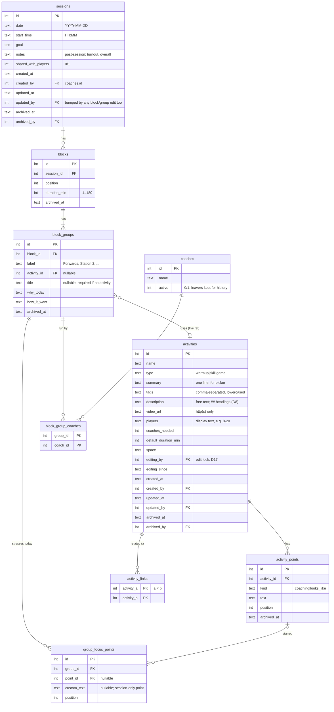

# feat: Rugby session planner v1

## Overview

This is a new, server-rendered web app where the Finsbury Park Men's coaches (~6 people) build, share and reuse training session plans. It replaces the weekly WhatsApp copy-paste message. The full product spec is in the brainstorm; this plan covers **how** to build it.

The stack follows the sibling apps: FastAPI + stdlib `sqlite3` with raw SQL + Jinja2 + vendored HTMX + plain CSS, with no build step. It deploys to the Hetzner box at `/srv/<slug>` on port 8005, behind Caddy and Cloudflare.

## Problem Statement

Today's plan is one WhatsApp message.
- **Changes:** editing it means re-posting the whole thing.
- **Activity details:** these need separate messages.
- **Reuse and linking:** there's no history, nothing to copy and nothing to link to.

Coaches want:
- one place where a session is built from a shared, growing activity library;
- clear time slots that can split into parallel groups;
- a goal at the top that each block ties back to;
- a read-only version for players.

## Decisions

These are additions to the brainstorm. They were answered by John, or chosen from research and the plan review. The **why** for each goes into `docs/decisions.md` in Phase 1.

### Product

| # | Decision |
|---|---|
| D1 | **Several coaches per group** (many-to-many). *(John)* |
| D2 | **Sessions are hidden from players until a coach flips "Share with players".** It's off by default and turned off again on copy. *(John)* |
| D3 | **Players don't see coach names.** *(John)* |
| D6 | **Every block has 1..N groups.** One group means everyone together; two or more means a split. There's no `kind` column. A group has an activity *or* a free-text title ("Water break", "Team talk"). |
| D7 | **Coaching points and "what good looks like" are rows in `activity_points`** (`kind = 'coaching' | 'looks_like'`), and starring them for a session is a link in `group_focus_points`, not copied text. Rewording a point on the card updates every session that starred it (live reference, as everywhere else). Deleting a point archives it, so old sessions still show what was stressed. A session-only point is a `group_focus_points` row with `custom_text` and no `point_id`. On the activity edit form, each point is its own row with ✕ and "+ add point". On save, the server updates rows it has an id for, inserts new ones and archives the ones that were removed. |
| D8 | **One free-text `description`** replaces how-to-run and progressions. A new activity starts pre-filled with `## Set up`, `## How to run` and `## Progressions`, each of which can be kept, filled in or deleted. When rendering, lines starting `## ` become headings and everything else becomes paragraphs. This is done by splitting in Python, so there's no markdown library and no `|safe`. **`summary` stays its own one-line field**, because the picker list and the player view need a short line. *(John)* |
| D24 | **Coaches are a table** (`coaches`: `id`, `name`, `active`), filled from a list in config on first run. There's no admin screen yet. Every `*_by` column, the edit lock and `block_group_coaches` reference `coaches.id`. A coach who leaves gets `active = 0` and disappears from pickers, but their name stays on past sessions and edits. |
| D26 | **Internal slug vs display name.** The internal slug is `rugby-coaching`, **permanently**: folder, repo, `/srv/rugby-coaching`, systemd unit, DB file, backup timer. The brand name exists only as the `APP_NAME` config value; templates print `{{ app_name }}`, and the brand never appears in code, file names or docs. A rename later = change `APP_NAME`, plus optionally a new subdomain with a Caddy redirect. This avoids the dance-time/wonderland split, where the brand leaked into service names, config and templates. |
| D25 | **The library items are called "activities"** (warm-ups, skill zones and game zones). "Drill" is reserved for one specific kind of skill zone. Tables, URLs and the UI all say *activity*. *(John)* |
| D9 | **Clock times are computed at render time** from `start_time` plus cumulative durations. Nothing time-based is stored. Blocks reorder with up/down buttons. Groups within a split don't reorder: they're ordered by creation, and labels like "Station 2" carry any order that matters. |
| D10 | **Conflict = the same coach on 2+ groups in one block.** It's a warning, never a blocker. |
| D11 | **Usage counts distinct live sessions dated ≤ today** (Europe/London). It shows the last date and count, plus non-empty "how it went" notes, newest first, each linking to its session. |
| D12 | **Copy a session from any session.** The new date defaults to the next occurrence of the source weekday on or after today. Copied: goal, start time, blocks, groups, coaches, why-today, starred points. Cleared: how-it-went, session notes, share flag. Two sessions on the same date are allowed. |
| D14 | **Players see every shared session dated today or later** (London time), soonest first. There's no history, no library and no activity pages for players. |
| D15 | **Player view** shows: the session goal, then for each block the times, group label, activity name and "why today". It hides coach names, coaching points, what good looks like, the description (including progressions), how it went and session notes. This is built by `player_projection()` (see Security). |

### Technical

| # | Decision |
|---|---|
| D4 | **The secret link is `/join/<key>`, not `#k=`.** A server-rendered app never receives the fragment. It sets a signed `SessionMiddleware` cookie holding the role and a key fingerprint, then 303s to `/`. The fingerprint is re-checked on every request, so rotating a key in `.env` logs out old links. *Rejected:* a JS landing page that POSTs the fragment. It keeps keys out of Cloudflare's logs, but WhatsApp is a far bigger leak surface anyway. |
| D5 | **The coach's id is stored in the same signed cookie**, server-side, as in holdings' `active_user`. It is not stored in localStorage, which happy showed gets evicted. You can view without picking a name; you must pick one before your first edit. The id is re-checked against active coaches on every request. |
| D16 | **Soft delete cascades by query, through SQL views.** The `live_blocks` and `live_groups` views join the parents' `archived_at IS NULL`. All reads go through them. `/deleted` lists only the topmost archived item, and a restored block goes to the end of its session. |
| D17 | **Concurrent edits: two cases.** **Session editing** is mostly taps (+, pick an activity, set minutes, tick coaches), and each tap saves at once and re-renders the page, so you see others' changes on your next tap. Here the **last save wins** (the susyncki approach), plus a "Last edited by Sam, 19:02" line on the session. **Activity cards** open in view mode; editing is a separate **Edit** button that takes a **lock** (`editing_by`, `editing_since` on `activities`). For **2 hours** nobody else can edit: they see "🔒 Sam is editing this (since 19:02)" and the Edit button is disabled. There is no override. After 2 hours the lock is free for anyone to take. Save and Cancel clear the lock. On save, the server checks `editing_by` is still you: a lock past 2 hours that nobody else took is still yours, so slow writers are fine. If someone did take it, nothing is overwritten and the form re-renders with your text intact and "Your edit lock expired and Sam is now editing — your version is below". New activities need no lock. There's no heartbeat, background job or live cursors. |
| D18 | **Sync stdlib `sqlite3` with raw SQL**, not susyncki's aiosqlite. Connections open in autocommit (`isolation_level=None`), inside the endpoint through a `with db() as conn:` context manager, not a `yield` dependency (threadpool thread-affinity). Every mutation runs inside `tx(conn)`, which issues `BEGIN IMMEDIATE`, so read-then-write moves can't interleave. |
| D19 | **Responses use plain forms with POST→303 everywhere, plus `hx-boost` on `<body>`** for smooth page swaps. HTMX fragments are used *only* for the picker's live search. A full re-render keeps clock times, totals and conflict badges right after any edit. Redirects target `#block-<id>` anchors. Validation errors re-render the form with **200**, never 4xx, because htmx won't swap 4xx and FastAPI's automatic 422 returns JSON. Form inputs are validated by hand. |
| D20 | **Seed the activities only when the `activities` table is empty** (first boot). After that, coaches own the library. |
| D21 | **Table naming: `block_groups` and `block_group_coaches`.** `GROUPS` is an SQLite keyword. "Group" stays the word used in the UI and URLs. |
| D22 | **Tags work like Notion's multi-select.** Chosen tags show as removable chips. Typing filters the existing tags (from `all_tags()`), and Enter adds the typed text as a new tag. It's ~40 lines of vanilla JS in `app.js`, and the result is stored as a comma-separated `tags` column. Without JS it falls back to a plain comma-separated text input. |
| D23 | **Frugal testing.** This is a local club tool, so the tests cover only the things that would really hurt (see Quality gates). There are no tests for ordinary CRUD; we check that by using the app. |

**Dropped after review:**
- the `team` column (adding it later with `ADD COLUMN` is a one-liner)
- the `seed_key` column
- the `activity_tags` table (now a `tags` text column)
- per-row audit columns on blocks and groups
- the undo-toast fragment
- the "removed — refresh" fragment
- auto-adding an activity created from the picker
- group reordering
- the no-coach, same-date and duplicate-name warnings
- partial indexes
- the 30-day window on `/deleted`
- the block-level `note` (e.g. "rotate every 5 min"); easy to add back as a column *(John)*

## Technical Approach

### Data model



- **Checks:**
  - `CHECK (type IN ('warmup','skill','game'))`
  - `CHECK (activity_id IS NOT NULL OR title IS NOT NULL)`
  - `CHECK (activity_a < activity_b)`
  - `CHECK (kind IN ('coaching','looks_like'))`
  - `CHECK (point_id IS NOT NULL OR custom_text IS NOT NULL)`
- **Views:** `live_blocks` and `live_groups` (D16).
- **Timestamps:** ISO TEXT, following susyncki.
- **DB file:** pinned to `DATA_DIR/rugby-coaching.db`. `server/backup.sh` backs up `data/*.db`.
- **Migrations:** v1 has no `_migrate()`. Add the susyncki-style detect-and-fix function the first time the schema changes.

### Access model and security

| Who | How they get in | Allowed routes |
|---|---|---|
| Coach | `/join/<COACH_KEY>` | Everything. Must pick a name before the first mutation. Has a "View as player" toggle. |
| Player | `/join/<PLAYER_KEY>` | **Allowlist only:** `GET /` and `GET /sessions/{id}` (shared sessions dated today or later; anything else gives 404) |
| Nobody | — | `/join/*`, `/healthz` and `/static/*`; everything else shows "Ask your coach for the link" |

- **Default-deny from Phase 1.** Every router is mounted with `dependencies=[Depends(require_coach)]`, except the explicit player allowlist. A test walks `app.routes` and asserts that `player_client` and `anon_client` get 403 or 404 on every route outside the allowlist. New routes are therefore covered automatically.
- **Requirements on mutations:**
  - `require_coach`
  - `current_coach`, which redirects to `/who?next=<path>`
  - `csrf_check`: Origin equals Host, falling back to Referer (susyncki)
  - SameSite=Lax as well; no CSRF tokens
- **`player_projection(session)`** builds a plain dict from an allowlist of fields. `player.html` receives only that dict, never the full tree, and never includes the coach partials.
- **Cookie contents:**
  - `role`
  - `kf` (an HMAC of the key with `SECRET_KEY`, truncated)
  - `coach_id`
- **Cookie settings:** `max_age` 1 year, `same_site=lax`, `https_only` in prod.
- **Joining and keys:**
  - Keys are compared with `hmac.compare_digest`.
  - **No downgrade:** a valid coach cookie is never overwritten by the player link. The coach is pointed to "View as player" instead.
- **Startup checks when `HTTPS_ONLY` is set:**
  - both keys are 20+ characters, generated with `secrets.token_urlsafe(16)` or longer;
  - the two keys differ;
  - neither is a dev default;
  - `SECRET_KEY` is set.
- **`/join` response:**
  - `Referrer-Policy: no-referrer` is set **only here**. App-wide, it makes browsers send `Origin: null`, and then every edit fails `csrf_check`.
  - `X-Robots-Tag: noindex`.
  - No `og:` tags.
- **Logs:** a uvicorn access-log filter redacts every `/join/…` path, including failed attempts. Caddy keeps **no** `log` directive for this site, and `setup.md` explains why.
- **Redirects:** no URLs are accepted from the client. "Create new activity" from the picker takes `session_id` and builds the redirect on the server. `/who?next=` accepts only paths starting with `/` and not `//` or `/\`.
- **XSS:**
  - Jinja autoescape stays on; **never `|safe`**.
  - The `description` is split into headings and paragraphs in Python, then looped in the template.
  - `video_url` is accepted only if `urlsplit` gives a scheme in `{http, https}` and a non-empty netloc. It renders with `rel="noopener noreferrer"`.
  - CSP header: `default-src 'self'; script-src 'self'`. This works because htmx is vendored.
- **Caching:** `NoStoreMiddleware` (holdings) sends `Cache-Control: no-store` on everything except `/static/`, which uses `?v=mtime` busting. Cloudflare respects origin headers.
- **Revocation:**
  - Rotating `COACH_KEY` or `PLAYER_KEY` logs out holders of that link.
  - Rotating `SECRET_KEY` logs everyone out.
  - Both are documented in `setup.md`.

### Routes

All mutations are `POST` and return 303 to the page (with a `#block-<id>` anchor). Validation failures return 200 with the form re-rendered.

```
GET  /join/{key}                 set cookie → 303 /
GET  /who      POST /who         pick coach name (?next= validated)
GET  /                           coach: Upcoming (asc) + Past (desc) + New session
                                 player: shared sessions dated ≥ today
GET  /sessions/new   POST /sessions
GET  /sessions/{id}              coach view | player view (role-picked; ?as=player for coaches)
GET  /sessions/{id}/edit  POST /sessions/{id}           date/start/goal/notes
POST /sessions/{id}/share        toggle
GET  /sessions/{id}/copy  POST /sessions/{id}/copy      date form → new session
POST /sessions/{id}/archive | /restore
GET  /sessions/{id}/picker       ?mode=block|group&block_id=&q=&type=   (HTMX fragment)
POST /sessions/{id}/blocks       activity_id|title, duration → block + first group
POST /blocks/{id}                duration
POST /blocks/{id}/move           dir=up|down (swaps with nearest live sibling)
POST /blocks/{id}/groups         add group → split
POST /blocks/{id}/archive | /restore
GET  /groups/{id}/edit  POST /groups/{id}   label, coaches, why_today, focus_points, how_it_went
POST /groups/{id}/archive | /restore
GET  /activities                     search + type/tag chips
GET  /activities/new  POST /activities   (?session_id= → back to that session after save)
GET  /activities/{id}                card + usage + notes + related
POST /activities/{id}/lock          take the lock (refused if someone else holds it <2h) → 303 edit form
GET  /activities/{id}/edit  POST /activities/{id}    edit form shows "used in N sessions"; save clears the lock
POST /activities/{id}/cancel        release the lock
POST /activities/{id}/archive | /restore
POST /activities/{id}/links   POST /activities/{id}/links/{other}/remove
GET  /deleted                    topmost archived items, newest first → Restore
GET  /healthz
```

### Key flows

1. **Build a session.** Create a new session (date; start time pre-filled from `DEFAULT_START_TIME`; goal), then tap **+**. The picker opens in a `<dialog>`.
   - **Picker contents:** search (`LIKE` on name, summary and tags, with a 200ms debounce), type chips, and a "Related to previous block" section. That section delivers the skill zone → game zone pairing.
   - **Adding an activity:** tap an activity to see its card, set the duration (pre-filled from the activity's default, or 10), then "Add to plan".
   - **Also available:**
     - "Free-text item" (title + duration)
     - "Create new activity" (activity form; saving returns to the session, and the coach then picks the new activity from the picker)
2. **Split.** "Add group" on a block opens the picker in group mode, without a duration. A group's edit form has:
   - **Label:** free text, with suggestions from labels used before (via a `<datalist>`)
   - **Coaches:** checkboxes
   - **Why today**
   - **Focus points:** the activity's coaching points as checkboxes ("draw out these two of the five"), plus "add your own" lines
   - **How it went:** shown only when the session date is today or earlier
3. **Reflow.** The header shows `19:30 → 21:05 · 95 min`. Each block shows `0–20 · 19:30–19:50`. Split groups stack vertically below ~600px.
4. **Copy.** Available from any session: "Copy to new session…", then a date form, then the new session opens.
5. **After a session.** Fill in "how it went" for each group and the session notes. The activity cards update.
6. **Delete.** Archiving redirects back with a "Deleted · Undo" banner (`?undone=` query parameter → restore POST). `/deleted` restores anything.
7. **Players.** The coach taps "Share with players" and posts the player link in WhatsApp once. Players open `/`.

### Edge cases

- **Archived activity still used in plans:**
  - Still rendered in plans, with an "archived" badge.
  - Hidden from the picker and from related links and suggestions.
  - The archive button warns "used in N sessions".
- **Block or group archived while someone else is viewing it:** their next POST gets a 404 page with a link back to the session.
- **Two groups → one:** the block becomes "everyone together", and the remaining label is kept but hidden.
- **Past sessions:** editable, wiki-style.
- **Unknown names:**
  - A coach marked inactive still shows by name on past sessions, but not in the pickers.
  - A cookie holding an inactive coach's id counts as "no name picked".
- **Empty states:**
  - no sessions → "Plan your first session"
  - an empty plan → a big +
  - an activity with no notes → the section is hidden
  - a player with nothing shared → "No session shared yet — check WhatsApp"
- **"Today":** always `zoneinfo("Europe/London")`.
- **WhatsApp in-app browser:** it has a separate cookie jar, so a coach may be asked "who are you?" twice. Accepted; `/who` shows a hint about it.

## Implementation Phases

### Phase 1: Foundation, deployed as a skeleton

- [x] **Scaffold:** `git init`, `.gitignore` (`.venv`, `data/`, `.env`), `requirements.txt` (fastapi, uvicorn[standard], jinja2, python-multipart, itsdangerous, pydantic-settings), `requirements-dev.txt` (pytest, httpx)
- [x] **`app/config.py`:** pydantic-settings with:
  - **Keys and secrets:** `COACH_KEY`, `PLAYER_KEY`, `SECRET_KEY`, `HTTPS_ONLY`
  - **Paths and names:** `DATA_DIR` (default `ROOT/data`), `APP_NAME` (name to be decided)
  - **Defaults:** `COACHES` (names used to fill the `coaches` table on first run, D24), `DEFAULT_START_TIME`, `TZ`
  - **Startup key checks** (see Security)
  - **`.env.example`:** dev keys
- [x] **`app/db.py`:**
  - **Connection:** `db()` context manager (autocommit; PRAGMAs WAL, `foreign_keys=ON`, `busy_timeout=5000`, `synchronous=NORMAL`; `sqlite3.Row`).
  - **Transactions:** `tx(conn)` issues `BEGIN IMMEDIATE`.
  - **Schema:** `SCHEMA` plus views; `init_db()`.
  - **DB path:** read from settings at call time, so tests just override settings.
- [x] **`app/auth.py`:**
  - **Join:** `/join` with no downgrade and the scoped `Referrer-Policy`.
  - **Dependencies:** `require_viewer`, `require_coach`, `current_coach`, `csrf_check`.
  - **Identity:** `/who` with a safe `next`.
  - **Logs:** the redaction filter.
- [x] **`app/main.py`:**
  - **Startup:** lifespan creates `DATA_DIR`, runs `init_db()`, then seeds.
  - **Middleware:** `SessionMiddleware`, `NoStoreMiddleware`, and the CSP header.
  - **Templates:** `asset_version()`.
  - **Routers:** mounted default-deny.
  - **Health:** `/healthz`.
- [x] **Templates and static:** `base.html` (mobile-first, safe-area insets, `hx-boost`, header with app name and coach name), `app/static/htmx.min.js` (htmx 2.x, committed), `app/static/app.css` (plain CSS) (`app.js` deferred to Phase 2–3, when there is JS to write)
- [x] **Deploy files:**
  - `deploy/rugby-coaching.service`: `User=deploy`, port 8005, `EnvironmentFile=/srv/<slug>/.env`, happy-sync hardening
  - `deploy/Caddyfile.snippet`: no `log` directive
  - `deploy/deploy.sh`: copied from susyncki
  - the `project-backup@<slug>.timer`
- [x] **Docs:**
  - `CLAUDE.md`: reference table, Key Conventions, project structure
  - `docs/setup.md`: local vs prod env, generating keys, rotating keys, the Caddy log warning
  - `docs/decisions.md`: the why behind D1–D21 and the brainstorm decisions
  - `docs/jots/`
- [x] **Tests** (see D23):
  - `tests/conftest.py`: a temp `DATA_DIR`, plus `coach_client`, `player_client` and `anon_client`
  - `tests/test_access.py`:
    - the **route-walk** default-deny test (players and anonymous users get 403 or 404 everywhere outside the allowlist; a cross-origin POST gets 403)
    - join sets the role, rotating a key invalidates the old cookie, and the player link doesn't downgrade a coach
- [x] **Deploy the skeleton** to `/srv/rugby-coaching` at `rugby-coaching.johng.me`.

**Done when:**
- coach and player links work on John's phone through Cloudflare;
- a real form POST from the phone succeeds (the CSRF check works behind the proxies);
- `/healthz` responds;
- the backup timer has fired.

### Phase 2: Activity library

- [x] `app/activities.py`:
  - CRUD, archive/restore; the activity edit lock (take, clear, check on save; D17)
  - `search(q, type, tag)`
  - `all_tags()`
  - links add/remove (a < b, no links to itself, archived activities hidden)
  - `usage(activity_id)` (D11)
- [x] Notion-style tag picker (D22) in `app.js`, plus tag chips for filtering in the library and the picker
- [x] Activity edit form: coaching points and "what good looks like" as editable rows (D7); save updates, inserts and archives rows in one `tx`
- [x] `app/text.py`: `render_description()` (D8), `valid_video_url()`
- [x] `app/routes/activities.py` + templates:
  - `activities/index.html`
  - `activities/show.html`: summary, description (set up / how to run / progressions), video, players/coaches/space/duration, coaching points, what good looks like, related, usage and notes
  - `activities/form.html`
- [x] `app/seed_activities.py`: about 18 activities (≈4 warm-up, ≈8 skill zone, ≈6 game zone).
  - **Pairing:** skill zones paired with game zones through related links.
  - **Wording:** our own, not copied from RFU text.
  - **Seeding:** inserted only into an empty table (D20).
- [ ] **John reviews the seed activities.** This runs in parallel with Phase 3 and must be done before Phase 6.

### Phase 3a: Sessions with single-group blocks

- [ ] `app/sessions.py`:
  - create/update session (D17)
  - add a block with its first group (in one `tx`)
  - edit duration
  - move (swap with the nearest live sibling, in one `tx`)
  - archive/restore (restore appends to the end)
  - `load_session(id)` returns the tree through the live views
  - every block or group mutation bumps the session's `updated_at` and `updated_by`, shown as "Last edited by Sam, 19:02" (D17)
- [ ] `app/timing.py`: `layout(blocks, start_time)` returns per-block relative and clock ranges plus the total and end time; `today_london()`
- [ ] `app/routes/sessions.py` + templates:
  - `sessions/show.html`
  - `_block.html` and `_group.html` includes
  - `_picker.html` (search, chips, related-to-previous, free-text item, create new activity)
  - `sessions/form.html`
- [ ] **Tests:** `tests/test_timing.py` covers reflow, total and end time, including splits.

### Phase 3b: Splits, coaches, focus points

- [ ] Add group / archive group; the group edit form with coaches (D1), why today, focus points (D7: tick the activity's coaching points, or add a session-only one) and how it went (date-gated)
- [ ] `timing.conflicts(block)` plus the badge (D10)
- [ ] Narrow-screen stacking; try a 5-group split on a phone

### Phase 4: History, reuse and recovery

- [ ] Coach home: Upcoming (ascending) and Past (descending); each row shows date, goal and block count
- [ ] Copy flow (D12)
- [ ] Session notes field (shown on or after the date)
- [ ] Activity card usage wired up
- [ ] `/deleted` (topmost archived items only) with Restore; the "Deleted · Undo" banner

### Phase 5: Player view

- [ ] `player_projection()`, `sessions/player.html`, player home (D14), share toggle (D2), "View as player" (`?as=player`)
- [ ] **Test** in `tests/test_player_view.py`: **marker-string redaction**. Every field gets a unique marker (`ZZ_COACHPOINT_1`, coach names and so on). Assert that **none** appear anywhere in the player HTML, including attributes and `/activities/` hrefs, and that an unshared session gives 404.

### Phase 6: Launch

- [ ] Generate real keys and put them in `/srv/<slug>/.env`; put the real coach names in config (they fill the `coaches` table); seed review is done
- [ ] John builds next session's plan in the app and shares the coach link in the coaches' WhatsApp
- [ ] Collect feedback in `docs/jots/`

## Alternative Approaches Considered

- **A static JS app with a JSON API (happy-style):** rejected in the brainstorm. Logic would sit in JS, and reflow would be duplicated.
- **A `#k=` fragment with a JS handshake:** see D4.
- **SQLModel:** this tree of joins reads more clearly in raw SQL, and susyncki is the newest precedent.
- **HTMX fragments for every mutation:** rejected in review. It needs two response paths, 4xx swap workarounds, and fragile partial reflow. Boosted full-page re-renders are simpler and always correct.
- **Real per-person auth:** rejected. The secret links plus the attribution cookie fit six coaches, and soft delete with `/deleted` covers mistakes and vandalism.
- **Rate limiting and CSRF tokens:** unnecessary given 128-bit keys, SameSite=Lax and the Origin check.

## System-Wide Impact

- **Shared host:** a new unit on port 8005, a new Caddy block in the `server` repo and a new backup timer. No other app is touched.
- **State lifecycle:**
  - every multi-row write runs in one `BEGIN IMMEDIATE` transaction: block plus first group, moves, copy, group plus coaches;
  - archiving is a single-row update and cascades through the views.
- **Error paths:**
  - **Validation errors:** 200 with the form re-rendered.
  - **Missing or archived rows:** 404 page.
  - **No cookie:** the join page.
  - **A player on a coach route:** 403/404.
  - **No coach name:** 303 to `/who?next=…`.
- **Integration scenarios:**
  1. Two coaches save the same group; the last save wins, and the session shows who edited it last.
  1b. Sam opens an activity for editing; John sees the lock and can't edit. After 2 hours John takes the lock; Sam's later save comes back with his text intact rather than overwriting John's.
  2. An activity is archived while it's in tonight's plan; it still renders with a badge and is gone from the picker.
  3. A session is copied and the copy shared, then the original is archived; the player sees the copy and usage stays correct.
  4. A key is rotated; old cookies hit the join page and the new link works.
  5. A coach taps the player link; they stay a coach.

## Acceptance Criteria

### Functional

- [ ] Coach and player links grant the right roles. With no cookie, you get a neutral page.
- [ ] Coaches create sessions with a goal and start time, and add blocks from a searchable picker with a pre-filled duration.
- [ ] Blocks split into any number of labelled groups, each with an activity (or free-text title), one or more coaches, why today and starred focus points.
- [ ] Clock and relative times reflow on any change. The session shows its total and end time.
- [ ] A coach double-booked within a block is flagged.
- [ ] Activitys can be created, edited, tagged, linked as related, archived and restored. Cards show usage and the rolled-up notes.
- [ ] Sessions can be copied from history to a new date.
- [ ] Anything deleted can be restored.
- [ ] Players see only shared sessions dated today or later, redacted per D15.
- [ ] About 18 seed activities, reviewed by John.

### Non-functional

- [ ] Usable one-handed at 360px wide: no horizontal scroll, tap targets ≥44px.
- [ ] Default-deny routing, proven by the route-walk test.
- [ ] Keys never appear in app logs; the startup checks enforce key strength in prod.
- [ ] `no-store` on every non-static response; CSP in place; no `|safe` anywhere.
- [ ] Nightly backups.

### Quality gates

- [ ] `pytest` passes. There are three small test files and no others unless a real bug earns one (D23):
  - `test_access.py`: the route walk, joining and key rotation
  - `test_player_view.py`: marker-string redaction
  - `test_timing.py`: reflow
- [ ] `CLAUDE.md`, `setup.md` and `decisions.md` are current.

## Success Metrics

- The next three training sessions are planned in the app rather than as WhatsApp text.
- At least two other coaches add or edit an activity in the first month.
- At least one session is made by copying a previous one.

## Dependencies & Risks

| Risk | Mitigation |
|---|---|
| Seed activities wrong or unrugby-like | John's review, before launch |
| Coach link leaks to a player | Rotate `COACH_KEY` and re-post; soft delete covers vandalism |
| `hx-boost` scroll or anchor quirks after a redirect | Fall back to plain page loads (remove one attribute); behaviour stays correct |
| Splits cramped on phones | Vertical stacking; 5-group test in Phase 3b |
| Name change later | `APP_NAME` is config; slug rename = new subdomain + Caddy redirect of `/join/*`; coaches re-tap the link once |
| Scope creep | Brainstorm "Later" list; jots |

**Inputs needed from John:** coach names, and the seed activity review.

## Future Considerations

- Equipment section and totalled kit list
- Squads (`ADD COLUMN team`)
- In-app coach list
- Final player-view contents (open in the brainstorm; only `player_projection()` and its template change)
- App name (only `APP_NAME` and optionally the subdomain change, D26)

## References

- Brainstorm: `docs/brainstorms/2026-10-16-session-planner-brainstorm.md`
- **DB:**
  - `../susyncki/app/database.py`: raw SQL, schema, susyncki-style detect-and-fix
  - `../leagues/app/database.py:60-110`: table rebuild
  - `../holdings/app/database.py`: PRAGMAs
- **Auth and identity:**
  - `../susyncki/app/auth.py`: `csrf_check`
  - `../holdings/app/active_user.py` and `../holdings/app/routes/actions.py:~88`: cookie identity picker
  - `../dance-time/app/routes/auth.py:~107-139`: link → session cookie, scoped `Referrer-Policy`
  - `../dance-time/app/main.py:94-112`: log redaction
- **Caching:**
  - `../holdings/app/main.py`: `NoStoreMiddleware`
  - `../server/CLAUDE.md`: Cloudflare respects origin cache headers
- **Deploy:**
  - `../susyncki/deploy/deploy.sh`, `../susyncki/deploy/susyncki.service`, `../happy/deploy/happy-sync.service` (hardening)
  - `../server/systemd/project-backup@.service`
- **Tests:** `../susyncki/tests/conftest.py`, `../susyncki/tests/test_auth.py`
